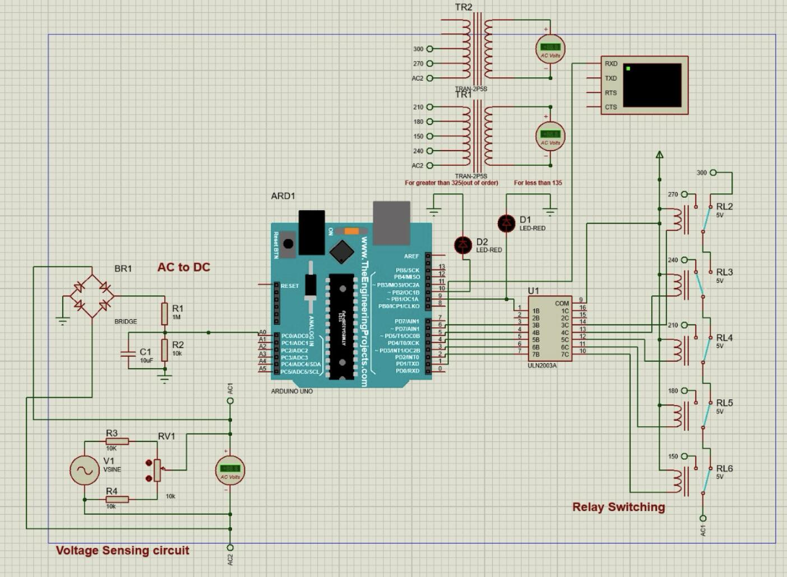

# Arduino-Based Automatic Voltage Stabilizer

**Original project:** December 2023 ·
**Keywords:** Arduino Uno · Proteus · Voltage Regulation · Relay Switching · ULN2003A · Embedded Systems




## Project overview

This project explores how an Arduino-based controller can detect input-voltage changes and select among transformer taps using electromechanical relays. The photographed circuit contains an AC-voltage sensing section, an Arduino Uno, a ULN2003A relay-driver IC, a switching bank, transformer models, voltage instruments, and indicators. A control algorithm processes a measured input-voltage estimate and decides which path should be selected. The goal is to illustrate automatic tap switching to keep the *conceptual* output near a target nominal value while avoiding unnecessary switching.

The original project description emphasizes continuous voltage monitoring, intelligent switching, and fewer relay activations. This reconstructed example includes filtering, a minimum hold interval, and hysteresis to demonstrate these objectives. Their performance is not independently verified against the original Proteus project.

## Architecture

```text
    AC input / simulated source
                |
                v
    Isolated sensing REQUIRED for hardware
                |
                v
      Conditioned DC measurement
                |
                v
         Arduino Uno A0
                |
       Filtering + calibration
                |
    Range check + tap selection
                |
      Hysteresis + hold timer
                |
       Break-before-make logic
                |
             Arduino
                |
         ULN2003A driver
                |
        Relay bank / tap path
                |
        Transformer output

    Serial monitor and status LEDs
```

## Original visible circuit

| Block | Components identified | Role |
|---|---|---|
| Controller | Arduino Uno (ARD1) | Samples an analog input; determines relay selection |
| Sensing | BR1 bridge, R1 1 MΩ, R2 10 kΩ, C1 10 µF | Rectification and filtering / dividing as shown |
| Adjustable virtual source | V1 (VSINE), R3 10 kΩ, R4 10 kΩ, RV1 10 kΩ | Input-voltage variation during simulation |
| Driver | ULN2003A (U1) | Drives relay coils from digital logic |
| Relay switching | RL2–RL6, marked 5 V | Visible relay bank; five relays |
| Magnetics | TR1 and TR2, `TRAN-2P5S` | Transformer models with several labeled taps |
| Monitoring | 3 AC voltmeters, virtual terminal | Intended measurement and serial observation |
| Indicators | D1, D2 (red LEDs) | Visible status indicators |

**Tap labels visible:** 150, 180, 210, 240, 270, 300 V. **Important:** Five relays are pictured for six voltage labels; the actual mapping is not derivable with confidence from a static screenshot. Additional text appears to mention faults above 325 V and below 135 V. See [schematic analysis](docs/schematic-analysis.md).

## Firmware — what is included

The Arduino sketch at [`firmware/VoltageStabilizer/VoltageStabilizer.ino`](firmware/VoltageStabilizer/VoltageStabilizer.ino) is a **newly designed reference reconstruction** featuring:

- A0 analog sampling at 100 ms intervals and exponential smoothing;
- configurable calibration placeholders (not calibrated voltage-measurement constants);
- tap selection by minimizing a *hypothetical* 230 V output error;
- no-tap fault state for unhandled voltages;
- optional switching hysteresis, minimum 3 s hold time, and 150 ms break-before-make;
- two status LEDs and human-readable output at 9600 baud;
- five placeholder ULN2003 relay-control signals;
- **disabled physical relay outputs by default** (`ENABLE_OUTPUTS = false`).

The sketch deliberately models five taps (150–270 V). The 300 V path shown in the diagram is **not implemented** because its switching mapping is unknown.

See [algorithm explanation](docs/control-algorithm.md) for the formula, parameters, and assumptions.

## Example calculation (theoretical only)

The *reference* transformer model assumes `V_out = V_in × 230 / selected_tap`. For a hypothetical input of 210 V and nominal tap of 210 V, the idealized output prediction is 230 V. This is a **reference computation, not an observation of the original circuit**; losses, saturation, contact behavior, under-load regulation, transformer configuration, and safety limits are not represented.

## Project folder

```text
voltage-stabilizer-arduino/
├── README.md
├── LICENSE
├── .gitignore
├── .github/workflows/python-tests.yml
├── assets/
│   ├── original-proteus-schematic.png
│   ├── original-project-description.png
│   └── illustrative-sweep.csv
├── docs/
│   ├── schematic-analysis.md
│   ├── control-algorithm.md
│   ├── safety-and-validation.md
│   └── github-upload-guide.md
├── firmware/VoltageStabilizer/
│   └── VoltageStabilizer.ino
├── hardware/
│   └── bill-of-materials.csv
├── scripts/
│   ├── control_model.py
│   └── demo.py
└── tests/
    └── test_control_model.py
```

## Quick start

### Run the software reference model

Requires Python 3.9+; no external packages.

```bash
python scripts/demo.py
python -m unittest discover -s tests -p 'test_*.py'
```

Outputs are written to `assets/illustrative-sweep.csv` and are clearly marked as illustrative. GitHub Actions runs the software model tests on push and pull request.

### View the Arduino sketch

1. Open `firmware/VoltageStabilizer/VoltageStabilizer.ino` in Arduino IDE.
2. Select **Board → Arduino AVR Boards → Arduino Uno**.
3. Verify/compile the sketch. Use simulated or isolated, bounded 0–5 V signals at A0 only; **never attach live AC to Arduino inputs**.
4. Use the serial monitor at 9600 baud. `ENABLE_OUTPUTS` is deliberately `false` so no relay actuation occurs.

See [safety and validation](docs/safety-and-validation.md).


## Documentation

- [Annotated analysis of the supplied schematic](docs/schematic-analysis.md)
- [Reconstructed control logic](docs/control-algorithm.md)
- [Safety and validation plan](docs/safety-and-validation.md)
- [GitHub upload instructions](docs/github-upload-guide.md)
- [Bill of materials](hardware/bill-of-materials.csv)

## License and attribution

The reconstructed source and written documentation are offered under the MIT license; see [LICENSE](LICENSE). Uploaded original screenshots remain the project owner's material. Cite the project owner as the original 2023 developer and describe the 2026 additions as a documented reconstruction, not as recovered original development artifacts.
